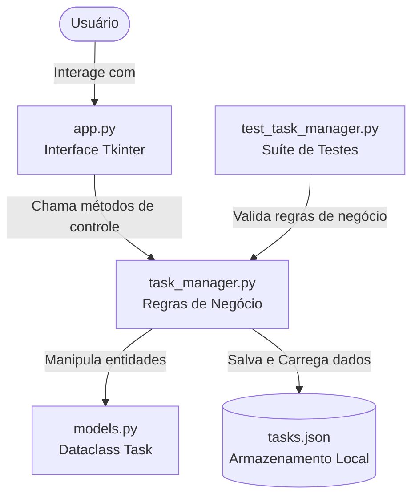

# 📝 Gerenciador de Lista de Tarefas (To-Do List)

Uma aplicação desktop moderna, intuitiva e didática para gerenciamento de atividades diárias, desenvolvida em **Python** com **Tkinter** e baseada no princípio de separação de responsabilidades (*Separation of Concerns*).

---

## 📌 Sumário
- [Visão Geral](#-visão-geral)
- [Funcionalidades Principais](#-funcionalidades-principais)
- [Arquitetura da Solução](#-arquitetura-da-solução)
- [Estrutura de Arquivos](#-estrutura-de-arquivos)
- [Pré-requisitos e Instalação](#-pré-requisitos-e-instalação)
- [Como Executar a Aplicação](#-como-executar-a-aplicação)
- [Guia de Uso da Interface](#-guia-de-uso-da-interface)
- [Validação e Suíte de Testes](#-validação-e-suíte-de-testes)
- [Decisões Técnicas e Boas Práticas](#-decisões-técnicas-e-boas-práticas)

---

## 🎯 Visão Geral

O projeto consiste em uma lista de tarefas com interface gráfica desktop que permite aos usuários acompanhar suas atividades pendentes e concluídas com facilidade. Ele foi desenvolvido sem dependências externas, utilizando exclusivamente os módulos nativos da biblioteca padrão do Python (`tkinter`, `dataclasses`, `json`, `datetime` e `unittest`).

---

## ✨ Funcionalidades Principais

| Funcionalidade | Descrição |
| :--- | :--- |
| **1. Adicionar Tarefas** | Digite o nome da atividade no campo de entrada e pressione `Enter` ou clique no botão **➕ Adicionar**. Espaços vazios são validados e rejeitados. |
| **2. Marcar como Concluída** | Clique no botão de alternância (`○` / `✔`) em cada card para marcar ou desmarcar a tarefa. As tarefas concluídas recebem texto tachado, selo verde e data/hora de conclusão. |
| **3. Remover Tarefas** | Clique no ícone de lixeira (`🗑️`) para excluir uma atividade. Uma caixa de diálogo de confirmação impede exclusões acidentais. |
| **Filtros Rápidos** | Alterne dinamicamente a exibição entre **Todas**, **Pendentes** e **Concluídas** com contadores em tempo real. |
| **Persistência Automática** | Todas as alterações são salvas automaticamente em disco no arquivo `tasks.json`, mantendo seus dados salvos entre reinicializações. |
| **Limpeza em Lote** | Opção no rodapé para limpar todas as tarefas concluídas de uma só vez. |

---

## 🏗️ Arquitetura da Solução

O projeto segue o padrão arquitetural em camadas, desacoplando o modelo de dados, as regras de negócio e a camada de apresentação visual:



### Componentes:
1. **`models.py` (Camada de Dados)**:
   - Define a entidade `Task` usando `@dataclass`.
   - Gerencia atributos essenciais: `id`, `title`, `completed`, `created_at` e `completed_at`.
   - Fornece métodos de serialização (`to_dict` e `from_dict`).

2. **`task_manager.py` (Camada de Negócio / Controlador)**:
   - Isola toda a lógica de manipulação: adição com sanitização, alternância de status, remoção, contadores estatísticos e filtros.
   - Gerencia o ciclo de persistência em formato JSON com tratamento de arquivos corrompidos ou inexistentes.

3. **`app.py` (Camada de Apresentação / View)**:
   - Constrói a interface visual com widgets do `Tkinter`.
   - Adota tipografia limpa (*Segoe UI*), paleta de cores moderna (*Tailwind Slate/Blue/Emerald*), scroll automático e *placeholders* interativos.

4. **`main.py` (Ponto de Entrada)**:
   - Inicializa a aplicação e dispara o loop de eventos (*mainloop*).

---

## 📂 Estrutura de Arquivos

```text
lista-tarefas/
│
├── main.py                 # Ponto de entrada para execução da aplicação
├── app.py                  # Interface gráfica (GUI Tkinter)
├── task_manager.py         # Lógica de negócios e persistência
├── models.py               # Definição do modelo de dados Task
│
├── test_task_manager.py    # Casos de teste unitários (unittest)
├── run_tests.py            # Script executor e relatório didático de testes
│
├── tasks.json              # Arquivo de persistência (gerado automaticamente)
└── README.md               # Documentação técnica e didática do projeto
```

---

## 💻 Pré-requisitos e Instalação

- **Python 3.8 ou superior** instalado (compatível com Windows, macOS e Linux).
- Não requer instalação de pacotes via `pip` (zero dependências externas).

Verifique sua versão do Python no terminal:
```bash
python --version
```

---

## 🚀 Como Executar a Aplicação

Abra o terminal na pasta do projeto e execute:

```bash
python main.py
```

A janela da **Lista de Tarefas** será aberta e centralizada na sua tela.

---

## 🖥️ Guia de Uso da Interface

1. **Adicionando uma Tarefa**:
   - Clique na caixa de texto onde está escrito `"O que você precisa realizar hoje?"`.
   - Digite o nome da sua atividade (exemplo: `Estudar Python para o projeto`).
   - Pressione `Enter` no teclado ou clique em **➕ Adicionar**.

2. **Gerenciando o Status**:
   - Cada card de tarefa possui um botão à esquerda:
     - `○` (Círculo cinza): A tarefa está **Pendente**.
     - `✔` (Sinal verde): A tarefa está **Concluída**.
   - Ao concluir, o texto recebe formatação tachada e a data/hora de conclusão é registrada.

3. **Filtrando Atividades**:
   - Clique nos botões no topo:
     - **Todas (N)**: Exibe a lista completa.
     - **Pendentes (N)**: Exibe apenas o que ainda falta fazer.
     - **Concluídas (N)**: Exibe apenas as tarefas finalizadas.

4. **Excluindo Tarefas**:
   - Clique no ícone de lixeira (`🗑️`) no canto direito do card.
   - Confirme a exclusão na caixa de diálogo que surgirá.
   - Para limpar todas as concluídas, clique no botão **Limpar concluídas** no rodapé.

---

## 🧪 Validação e Suíte de Testes

A integridade do software é garantida por uma suíte de testes unitários automatizados desenvolvida com o framework nativo `unittest`.

### Executando os Testes

Para executar o relatório completo de validação:

```bash
python run_tests.py
```

Ou diretamente pelo módulo padrão:

```bash
python -m unittest test_task_manager.py -v
```

### Casos de Teste Cobertos

| Caso de Teste | Descrição da Validação | Status |
| :--- | :--- | :---: |
| `test_add_task_success` | Criação de tarefa válida com ID, status pendente e data de criação. | ✅ Passou |
| `test_add_multiple_tasks_increments_id` | Atribuição de identificadores únicos sequenciais (1, 2, 3...). | ✅ Passou |
| `test_add_task_trims_whitespace` | Remoção de espaços vazios no início e término do título. | ✅ Passou |
| `test_add_task_empty_or_whitespace_raises_value_error` | Lançamento de exceção `ValueError` ao tentar criar tarefa sem texto. | ✅ Passou |
| `test_toggle_task_status` | Transição de status (Pendente ➔ Concluída ➔ Pendente) e gravação de timestamp. | ✅ Passou |
| `test_toggle_nonexistent_task` | Retorno seguro `False` ao tentar alternar ID inexistente. | ✅ Passou |
| `test_set_task_status_explicit` | Atribuição explícita de `True` ou `False` para o status. | ✅ Passou |
| `test_remove_task_success` | Exclusão de tarefa da lista e atualização dos contadores. | ✅ Passou |
| `test_remove_nonexistent_task` | Tratamento seguro ao tentar remover ID inexistente sem quebrar a execução. | ✅ Passou |
| `test_filter_tasks` | Filtragem precisa por `"all"`, `"pending"` e `"completed"`. | ✅ Passou |
| `test_get_summary_counts` | Cálculo correto de totais, pendências e concluídas. | ✅ Passou |
| `test_clear_completed` | Exclusão em lote apenas dos itens com status concluído. | ✅ Passou |
| `test_persistence_save_and_load` | Serialização em JSON, recarregamento e verificação de fidelidade de dados. | ✅ Passou |
| `test_persistence_corrupted_file` | Recuperação graciosa e tolerância a falhas caso o arquivo JSON esteja ilegível. | ✅ Passou |

---

## 🛡️ Decisões Técnicas e Boas Práticas

1. **Zero Dependências Externas**:
   - Garante que a aplicação funcione imediatamente em qualquer ambiente que possua Python instalado, sem falhas de rede ou incompatibilidade de pacotes.
2. **Separação de Camadas (MVC Simplificado)**:
   - A lógica de negócios (`task_manager.py`) não possui qualquer dependência de bibliotecas de interface visual, permitindo que seja testada 100% de forma headless e automatizada.
3. **Resiliência e Tratamento de Erros**:
   - Manipulação segura de arquivos de entrada e saída.
   - Proteção contra dados corrompidos ou entradas vazias pelo usuário.
4. **Experiência do Usuário (UX)**:
   - Suporte a rolagem com a roda do mouse (*Mouse Wheel*).
   - Atalho de teclado rápido (`Enter`).
   - Feedback visual imediato e estados vazios amigáveis com ilustrações em emoji.
